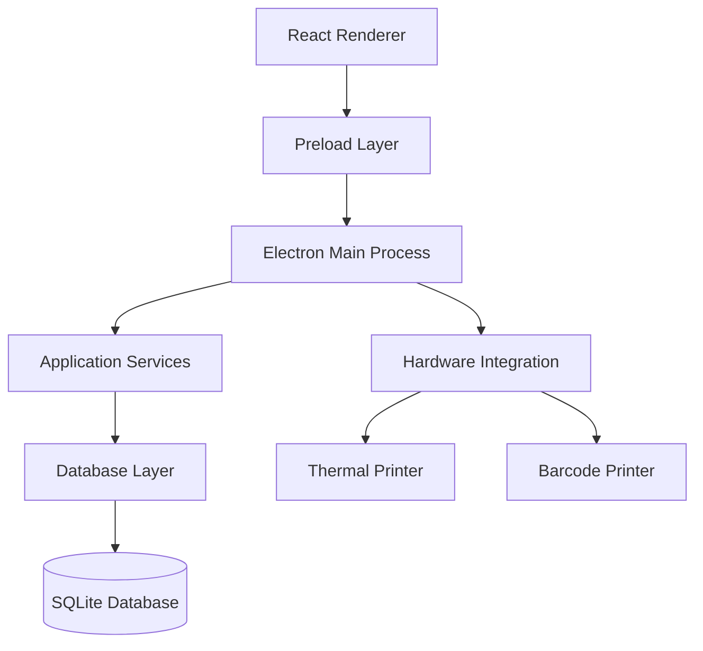

# 🛒 Kirana POS — Offline-First Retail Billing & Inventory Management

A desktop Point of Sale (POS) application designed to simplify everyday retail operations. Kirana POS brings billing, inventory management, purchase tracking, supplier management, sales reporting, and receipt printing together in one application.

Built with **Electron, React, TypeScript, and SQLite**, the application is designed to support retail workflows with locally stored data and offline-first operation.

<p align="center">
  <strong>Fast Billing · Inventory Control · Purchase Management · Business Reports</strong>
</p>

---

## 📌 Overview

Managing a small retail store involves more than generating bills. Store owners also need to track stock, manage suppliers, record purchases, handle returns, and understand daily sales.

Kirana POS aims to simplify these operations through a unified desktop application.

### Key Highlights

- Offline-first desktop application
- Local SQLite database for data storage
- Retail billing and multiple payment methods
- Product and inventory management
- Purchase and supplier management
- Sales reports and CSV exports
- Thermal receipt and barcode label printing
- Database backup and restore

---

## ✨ Features

### 1. Billing & Sales Management

Manage day-to-day retail transactions through the billing interface.

- Generate bills with sequential bill numbers.
- Support cash, UPI, and mixed payment methods.
- Maintain customer details with sales records.
- Manage multiple billing slots.
- View and manage previous bills.
- Handle sales returns and refunds.
- Edit existing sales records.

### 2. Product & Inventory Management

Keep product information and stock records organized.

- Create and manage product records.
- Maintain barcode information.
- Generate and print barcode labels.
- Track stock adjustments and stock history.
- Monitor low-stock products.
- Manage batch-wise inventory.
- Track expiry dates and free quantities.

### 3. Purchase & Supplier Management

Manage incoming stock and supplier-related records.

- Record purchase invoices.
- Maintain supplier information.
- View purchase history.
- Track supplier balances.
- Support credit purchases.
- Update inventory through purchase workflows.

### 4. Reports & Business Insights

Access sales information to understand store activity.

- Daily sales reports.
- Bill-wise reports.
- Product-wise reports.
- Payment summaries.
- Date-based report filtering.
- Export report data to CSV.

### 5. Printing & Hardware Integration

Support common retail printing workflows.

- Thermal receipt printing.
- Barcode label printing.
- TSPL-based barcode label output.
- Detect installed printers.
- Configure and test printer connections.

### 6. Database & Data Management

Keep business data locally managed.

- SQLite-based local database.
- Database migration support.
- Backup and restore functionality.
- Backup integrity checks.
- Safety backup before database restoration.

---

## 🧰 Technology Stack

| Layer | Technologies |
|---|---|
| Desktop Framework | Electron 39 |
| Frontend | React 19 |
| Language | TypeScript |
| Build Tool | Electron Vite, Vite |
| Database | SQLite |
| Database Driver | better-sqlite3 |
| Testing | Vitest |
| Code Quality | ESLint, Prettier |
| Packaging | electron-builder |

---

## 🏗️ Application Architecture

Kirana POS follows a desktop architecture that separates the user interface from privileged desktop operations and database access.



### Architecture Components

- **Renderer:** React-based user interface for billing, inventory, purchases, and reports.
- **Preload:** Provides a controlled bridge between the renderer and Electron's main process.
- **Main Process:** Handles desktop application operations and IPC communication.
- **Services:** Encapsulate application workflows and business operations.
- **Database Layer:** Manages SQLite access, repositories, and migrations.
- **Hardware Integration:** Handles printer-related operations.

---

## 📂 Project Structure

The application is organized around Electron's main, preload, and renderer processes.

```text
kirana-pos/
├── src/
│   ├── main/
│   │   ├── database/
│   │   ├── services/
│   │   └── ...
│   ├── preload/
│   └── renderer/
│       └── src/
│           ├── components/
│           ├── pages/
│           └── ...
├── package.json
├── electron.vite.config.ts
└── README.md
```

*Note: This is a simplified overview of the source organization.*

---

## 🚀 Getting Started

### Prerequisites

- Node.js and npm
- Git
- A supported desktop operating system
- Required native build tools for `better-sqlite3` if your environment needs them

### 1. Clone the Repository

```bash
git clone https://github.com/prathamesh0225/kirana-pos.git
```

### 2. Navigate to the Project

```bash
cd kirana-pos
```

### 3. Install Dependencies

```bash
npm install
```

### 4. Run in Development Mode

```bash
npm run dev
```

### 5. Build the Application

```bash
npm run build
```

### 6. Create a Platform-Specific Build

**Windows**
```bash
npm run build:win
```

**macOS**
```bash
npm run build:mac
```

**Linux**
```bash
npm run build:linux
```

---

## 🧪 Testing & Code Quality

The project includes Vitest for automated tests and TypeScript checks.

Run tests:

```bash
npm test
```

Run TypeScript checks:

```bash
npm run typecheck
```

Run linting:

```bash
npm run lint
```

Format the code:

```bash
npm run format
```

---

## 🔐 Data Storage & Offline-First Approach

Kirana POS uses SQLite through `better-sqlite3` for local data persistence.

This approach supports local operation without requiring a continuously available cloud database connection.

The application also includes database migration, backup, restore, and integrity-checking workflows to support data management.

---

## 🎯 Project Goals

The project focuses on building a practical retail management solution while exploring:

- Desktop application development with Electron.
- Component-based UI development with React.
- Type-safe application development using TypeScript.
- Local database design and SQLite integration.
- IPC communication between Electron processes.
- Business workflow implementation.
- Hardware integration for retail printing.
- Automated testing and application packaging.

---

## 🛠️ Future Improvements

Potential areas for further development include:

- Multi-user authentication and role-based access.
- Cloud synchronization and multi-device support.
- Advanced inventory and profit analytics.
- Automated low-stock notifications.
- Enhanced dashboard visualizations.
- More printer models and hardware compatibility.
- Automated database backup scheduling.

---

## 👨‍💻 Author

**Prathamesh Pawar**

Software Developer | Full-Stack & Desktop Application Development

- GitHub: [@prathamesh0225](https://github.com/prathamesh0225)
- Project Repository: [Kirana POS](https://github.com/prathamesh0225/kirana-pos)

---

## 📄 License

Please refer to the repository's license information for usage and distribution terms.